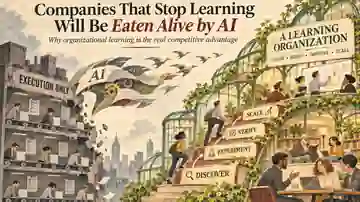

# Companies That Stop Learning Will Be Eaten Alive by AI

*Why organizational learning, not automation, will determine competitive advantage in the age of artificial intelligence*

*November 2026 · Strategic management essay*

## Abstract

The rapid adoption of artificial intelligence has prompted organizations to reconsider the economic value of human labor, particularly entry-level knowledge workers. A prevailing argument suggests that as AI systems become capable of performing tasks traditionally assigned to junior employees, companies can improve efficiency by eliminating those positions. Although economically attractive in the short term, this reasoning overlooks a critical function of human capital: organizational learning.

This essay argues that AI fundamentally changes the relationship between productivity, knowledge acquisition, and competitive advantage. As AI reduces the cost of executing established tasks, the capacity to discover, evaluate, absorb, and institutionalize new knowledge becomes increasingly important. Organizations that optimize exclusively for immediate productivity risk sacrificing the capabilities necessary for long-term adaptation.

Drawing on established theories of organizational learning, absorptive capacity, dynamic capabilities, and human capital investment, this essay proposes that continuous learning should become a central organizing principle of AI-native enterprises. Junior engineers and other early-career professionals remain strategically important not simply because of their current productive contributions, but because of their potential role in exploration, experimentation, and organizational renewal.

**AI may increasingly commoditize certain forms of execution while increasing the strategic value of an organization's capacity to learn faster than its competitors.**

## 1. Introduction: The Productivity Trap

One of the most consequential management questions raised by generative artificial intelligence is whether companies should continue hiring junior engineers and other entry-level knowledge workers.

The argument for reducing junior hiring appears straightforward. Historically, junior engineers performed relatively simple technical tasks while acquiring the experience necessary for more sophisticated responsibilities. Today, AI coding assistants and autonomous software agents can increasingly perform portions of that work. Senior engineers equipped with AI may consequently accomplish tasks that previously required teams of developers.

From the perspective of immediate labor productivity, replacing junior-level tasks with AI appears rational.

However, this reasoning rests on a questionable assumption: that the primary economic purpose of a junior employee is to perform relatively inexpensive work.

Employees are not merely productive resources. They are also repositories of accumulated knowledge, participants in organizational experimentation, and potential future leaders.

A junior engineer who spends several months exploring an unfamiliar technology may initially contribute less to immediate output than an experienced engineer focused on established production tasks. Nevertheless, the junior engineer may develop expertise that enables the organization to adopt an important new capability.

The distinction is fundamental. Traditional productivity analysis asks how efficiently an organization performs its existing activities. Strategic management must also consider how effectively the organization adapts when those activities become obsolete.

This concern predates generative AI. Peter Senge (1990) argued that long-term organizational performance depends on the capacity for continuous learning. Similarly, James March (1991) distinguished between exploiting existing knowledge and exploring new possibilities.

AI does not create the importance of organizational learning. Rather, it may dramatically amplify it.

As access to sophisticated computational capabilities becomes more widespread, established methods of performing knowledge work can become easier to replicate. Competitive advantage may therefore depend increasingly on how rapidly firms discover better methods, verify their effectiveness, and incorporate them into operations.

**In an AI-driven economy, a firm's capacity for organizational learning becomes an essential strategic capability. Companies that systematically neglect it risk being overtaken by competitors that learn and adapt more effectively.**

## 2. From Operational Efficiency to Organizational Learning

### 2.1 The exploration–exploitation dilemma

March's (1991) framework provides a theoretical foundation for understanding the strategic problem.

Organizations allocate limited resources between two competing activities. **Exploitation** concerns the refinement and efficient application of existing knowledge: standardization, execution, optimization, and improvement of established processes. **Exploration** concerns the discovery of new possibilities: experimentation, research, unfamiliar technologies, and the development of capabilities whose economic value remains uncertain.

Exploitation generally produces more immediate and measurable returns. Exploration involves greater uncertainty, longer time horizons, and outcomes that are difficult to predict. Consequently, organizations frequently favor exploitation.

A software engineering manager evaluated on quarterly delivery targets has an incentive to assign experienced engineers to production tasks rather than exploratory projects. An engineer experimenting with a new verification methodology may appear less productive than one completing established development assignments.

March argued that excessive exploitation can produce strong short-term results while undermining long-term adaptation. AI may intensify this problem.

When AI makes established tasks easier to perform, managers can achieve impressive productivity improvements without fundamentally changing their organization's capabilities. A company might generate more code, complete more tickets, or produce more documentation while becoming no better at identifying the technologies, products, and methods that will matter in the future.

This is the **AI productivity trap**: optimizing the efficiency of current work while underinvesting in the capacity to discover better work.

### 2.2 Dynamic capabilities and changing competitive advantage

Teece, Pisano, and Shuen (1997) introduced the concept of dynamic capabilities to explain how firms develop and renew competitive advantage under conditions of technological change.

Their framework emphasizes that possessing valuable resources is insufficient when the competitive environment changes. Firms must also integrate, build, and reconfigure their competencies.

Consider two software companies with comparable access to frontier AI models.

The first focuses on automating its existing development process. It uses AI to generate code faster, reduce documentation overhead, and increase output per engineer.

The second uses the same AI capabilities but also continuously investigates new architectures, development methodologies, testing strategies, and product opportunities.

Both may improve productivity initially. However, the second may accumulate advantages that extend beyond task-level automation: methods that reduce verification costs, improve quality, or enable new products.

The crucial difference is not access to AI itself, but the organizational capability to discover and implement better uses of AI.

This does not imply that proprietary data, capital, distribution, or customer relationships cease to matter. Those resources can remain powerful sources of competitive advantage. Rather, organizational learning increasingly determines how effectively such resources can be renewed and deployed.

## 3. AI Changes the Economics of Knowledge and Execution

### 3.1 Evidence that AI can increase productivity

Empirical research supports the proposition that AI can improve the execution of knowledge-work tasks, although effects vary.

Brynjolfsson, Li, and Raymond (2025), in *The Quarterly Journal of Economics*, studied generative AI assistance among 5,172 customer-support agents. They reported an average productivity improvement of approximately 15%, measured by issues resolved per hour, with benefits concentrated among less experienced and lower-skilled workers.

AI can therefore reduce the marginal cost of certain knowledge-intensive activities and potentially accelerate the transfer of established practices across employees. But **faster execution does not necessarily imply a corresponding improvement in organizational learning**.

### 3.2 AI capabilities are uneven

The benefits of AI are not universal. Dell'Acqua and colleagues (2026) investigated generative AI in professional consulting work and introduced the *jagged technological frontier*: AI performs some knowledge tasks exceptionally well while struggling with others that appear similarly difficult.

In software engineering, Becker and colleagues (2025) found that experienced open-source developers working on familiar repositories took 19% longer to complete tasks when allowed to use the AI tools evaluated in their experiment.

That study should not be generalized to all software development or later AI systems. It does show why managers must distinguish perceived productivity from measured outcomes.

Together, these studies suggest that evaluating AI's performance, recognizing its limitations, and identifying productive applications are themselves important organizational capabilities.

The strategic question changes from *How much work can AI automate?* to *How quickly can our organization discover where AI creates genuine value, where it does not, and how our practices should change accordingly?*

### 3.3 The new scarcity: verified knowledge

As AI lowers the cost of generating potential solutions, it can increase the volume of available alternatives. Engineers can explore numerous implementations, designs, architectures, and hypotheses at relatively low cost.

But generating possibilities is not equivalent to acquiring useful knowledge. A proposed solution must still be evaluated for correctness, reliability, performance, cost, security, and business value.

For example, an AI agent may generate many alternative implementations of a hardware component. Yet only those that pass appropriate simulation, formal verification, synthesis, and performance requirements represent validated engineering outcomes.

**The scarce resource is not necessarily the ability to generate solutions. It is the organizational capacity to identify which solutions are worth trusting, adopting, and scaling.**

## 4. Organizational Learning as a Compounding Asset

### 4.1 From individual discovery to organizational capability

Cohen and Levinthal (1990) introduced *absorptive capacity*: a firm's ability to recognize the value of new external information, assimilate it, and apply it commercially.

Their research highlights the cumulative nature of organizational learning. An organization familiar with automated testing may be better positioned to evaluate AI-generated code. Experience with AI-generated code may improve its ability to develop autonomous software agents. Experience with autonomous agents may then help it automate more sophisticated engineering processes.

Each verified improvement can become the foundation for subsequent discoveries.

But the process is not automatic. An engineer's personal knowledge does not necessarily become organizational knowledge. Discoveries can remain isolated within individuals, teams, documents, or experiments.

To generate lasting value, organizations must institutionalize successful learning in software libraries, tests, engineering standards, reusable agent skills, evaluation systems, training materials, or operating procedures.

The critical transition occurs when an individual's discovery becomes a capability that other employees and systems can reliably use.

### 4.2 The organizational learning loop

An AI-native learning organization should establish a repeatable process:

1. **Discover:** Identify emerging technologies, operational bottlenecks, and opportunities.
2. **Experiment:** Use human expertise and AI-assisted exploration to investigate alternatives.
3. **Verify:** Establish whether alternatives produce genuine improvements under defined acceptance criteria.
4. **Institutionalize:** Convert successful results into persistent organizational assets.
5. **Scale:** Deploy those capabilities across teams, products, and AI agents, then repeat.

The process can compound. Better verification tools reduce the cost of testing new approaches. Reusable agent workflows expand experimentation capacity without proportionally increasing human labor.

Beraja and Talamàs (2026) model AI as a potential organizational learning technology, emphasizing the economic value of accelerating organizational-capital accumulation. Their model is a theoretical contribution, not an established quantitative forecast, but it reinforces the idea that AI's value extends beyond labor replacement to improving organizational learning itself.

## 5. Why Eliminating Junior Engineers May Be a Strategic Error

### 5.1 The incomplete economics of junior employment

The argument for eliminating junior engineers treats employment primarily as a transaction involving current labor productivity. An inexperienced engineer requires training, supervision, and time; an AI agent may perform some tasks more cheaply.

If current output were the only consideration, reducing junior employment could be justified. But junior employment is also an investment in future capabilities. Junior engineers acquire expertise, understand company systems, develop judgment, and eventually assume more sophisticated responsibilities.

Eliminating junior positions may reduce immediate costs while weakening the future talent pipeline.

Recent labor-market research makes this concern relevant. Westby, Modestino, and Cheng (2026) report a 14–15% relative decline in junior versus senior software developer vacancies following ChatGPT's public release, alongside rising experience requirements. Separately, Brynjolfsson, Chandar, and Chen (2026) documented that employment among workers aged 22–25 in AI-exposed occupations stood 19% below the level it would have reached had it kept pace with less-exposed occupations through June 2026.

The latter result is descriptive rather than a causal estimate of AI's employment effect, and the researchers found no evidence of widespread economy-wide displacement. Nevertheless, narrowing early-career opportunities deserve attention.

The question for individual firms is whether reduced junior hiring properly accounts for the cost of developing future experienced professionals.

### 5.2 The comparative advantage of junior engineers in learning

Junior engineers need not possess an absolute advantage in learning. Experienced engineers may master unfamiliar concepts faster because of deeper foundational knowledge.

But juniors may have a **comparative advantage in exploratory assignments because of the opportunity cost of their time**.

A senior engineer might investigate a new development methodology in two weeks while a junior takes four. Yet assigning the senior may displace costly architectural decisions, production responsibilities, or technical leadership.

The correct comparison is not simply hours needed to learn. It is the total economic cost of acquiring, validating, and applying knowledge, including displaced work, mentorship, risk, and future benefits.

That advantage is conditional. Explorations requiring substantial expertise may be best led by seniors; poorly supervised junior exploration may create waste. Often the best arrangement combines senior judgment, junior experimentation, and AI-assisted execution.

### 5.3 AI can reduce the cost of apprenticeship

Traditionally, junior engineers consumed significant senior time through training, debugging assistance, code review, and mentorship. AI can help restructure that relationship by providing explanations, practice exercises, reviews of straightforward mistakes, and exploratory assistance.

Seniors can focus on higher-value mentoring: judgment, architecture, risk assessment, and trade-offs.

However, AI-assisted task completion is not the same as learning. In a 2026 randomized study involving 52 software developers, Shen and Tamkin found that participants using AI assistance scored 17 percentage points lower on an immediate assessment of newly acquired coding knowledge than developers working without AI assistance.

The manner of interaction mattered: using AI to understand concepts was associated with stronger learning than simply requesting solutions.

**AI can be an accelerator of learning or a substitute for the cognitive effort through which learning occurs.** Companies should build apprenticeships around demonstrated understanding, independent verification, and increasingly challenging responsibility.

## 6. The Retention Objection: Why Train Employees Who Might Leave?

A common objection is that competitors may recruit junior employees after the company invests in their development. The concern is economically legitimate: employees own substantial control over their knowledge and career choices.

Acemoglu and Pischke (1999) examined conditions under which employers invest in general training, demonstrating that the economics depend on labor-market institutions and wage structures—not a simple rule against transferable skills.

AI-native firms should consider expected returns, employee retention, transferability of skills, and their ability to benefit from shared organizational knowledge.

Possible turnover does not automatically make training irrational. Companies can improve the returns through competitive compensation, challenging work, career opportunities, professional autonomy, and a culture where people want to stay.

They should also ensure individual learning becomes organizational capability. When an engineer turns a superior verification methodology into reusable workflows, test infrastructure, and shared standards, the company retains much of the benefit even if the individual leaves.

A firm that refuses to develop employees because they might depart accepts another risk: that its workforce and practices fail to evolve.

The objective is not zero turnover but a development and retention system whose expected long-term benefits exceed its costs.

## 7. Making Learning the Center of Management

Declaring learning a corporate value is insufficient. The management system must allocate resources, establish accountability, and measure results accordingly.

### 7.1 Resource allocation

Exploration should be explicitly funded rather than treated as something employees do after production work. Firms can use technical research assignments, bounded experimental projects, cross-functional teams, and junior-led investigations with senior review.

The allocation should vary with business uncertainty and competitive pressure; no universal percentage is appropriate. But allocating no meaningful resources to exploration is a bet that existing capabilities will remain sufficient.

### 7.2 Performance management

Traditional engineering measures emphasize completed tasks, output, and delivery milestones. These remain useful, but can undervalue knowledge creation.

Performance reviews should recognize improvements that benefit the organization beyond an individual's immediate assignment. A reusable verification framework may create more long-term value than a larger count of completed tickets. A reliable negative result on a proposed technology can prevent a costly mistake.

The distinction is disciplined learning that produces credible evidence and better decisions—not activity for its own sake.

### 7.3 Knowledge infrastructure

Organizations need mechanisms that preserve and distribute verified discoveries.

Where possible, knowledge should be operationalized in automated acceptance tests, reproducible benchmarks, validated reference implementations, reusable agent instructions, and continuously maintained workflows.

A document explaining how to solve a recurring problem has value. A validated process that reliably solves it across teams may have substantially more.

### 7.4 Learning culture and psychological safety

Edmondson (1999) found psychological safety was associated with learning behavior in work teams. Employees are less likely to expose mistakes or challenge assumptions when doing so threatens their standing.

A company that celebrates innovation publicly but punishes every unsuccessful experiment creates contradictory incentives.

Learning-centered management must distinguish responsible experimentation from negligence. Engineers should be accountable for experimental discipline, evidence quality, and risk management—not for guaranteeing every hypothesis succeeds.

## 8. Measuring Organizational Learning as a Strategic Capability

Traditional productivity measures estimate how efficiently firms convert inputs into current outputs. A learning-centered organization must also evaluate how rapidly it develops capabilities that improve future outcomes.

One proposed measure is the **Verified Capability Adoption Rate**: the number of materially useful, independently validated improvements adopted across an organization within a defined period.

It could count improvements to development processes, reusable technical infrastructure, automation systems, or product capabilities. But counting alone encourages trivial changes and metric gaming.

The measure therefore needs companions such as realized cycle-time reductions, lower defect rates, reduced operating costs, and shorter time to deliver valuable functionality.

Managers should also monitor time from identifying a promising opportunity to deploying a validated improvement.

**Experimentation throughput** is how many possibilities the organization investigates. **Learning effectiveness** is how well it turns those investigations into reliable decisions and usable capabilities.

The goal is not to maximize the number of experiments but to maximize economically valuable learning within prudent cost and risk constraints.

*The Verified Capability Adoption Rate is a proposed management concept, not an empirically validated metric.*

## 9. Limitations and Counterarguments

The thesis should not be taken to mean every firm must maximize exploration.

Some businesses operate in relatively stable environments where execution, cost control, regulation, or customer relationships matter more than rapid experimentation.

Continuous exploration can destroy value if organizations never exploit discoveries. March's framework requires a balance of exploration and exploitation.

Companies can also acquire expertise externally through partnerships, acquisitions, consultants, and experienced hires rather than relying solely on internal junior development.

AI systems themselves can contribute to organizational learning through persistent memory, retrieval, evaluation, and model improvement. The distinction is not that AI cannot learn, but that producing a correct answer and building durable organizational capability are different processes.

Finally, learning speed alone cannot guarantee commercial success. Firms still need viable economics, operational discipline, customers, and the means to capture value.

These qualifications strengthen the thesis. **Learning is not a substitute for execution. It is how execution stays relevant as circumstances change.**

## 10. Conclusion: The Learning-Centered Enterprise

AI is changing the economics of knowledge work. Activities that once required significant human effort can increasingly be supported or performed by computational systems. As those capabilities spread, organizations that compete primarily through efficient execution of established tasks may see portions of their advantage erode.

The managerial response should not be limited to reducing labor costs or increasing work volume. Leaders must reconsider what creates enduring value.

The traditional firm sought to accumulate expertise and apply it efficiently. The AI-native firm must also continuously renew that expertise.

Junior engineers should not be assessed solely by whether AI can perform their current tasks. Their contribution to experimentation, knowledge development, and future leadership must enter the investment case.

Senior engineers should be valued not only for solving difficult problems but also for mentoring others and turning discoveries into shared capabilities.

AI agents should help expand experimentation, evaluation, and improvement—not merely automate the status quo.

Above all, learning cannot remain a secondary responsibility competing with real work.

**In an AI-native enterprise, learning is part of the real work.**

A company that fails to learn may continue reporting impressive short-term productivity gains, deploying sophisticated AI agents, automating operations, and reducing headcount. None guarantees competitiveness when its methods are surpassed.

The most important management question is not how many employees AI can replace. It is how quickly the organization can develop, validate, and deploy the capabilities necessary for its next stage of competition.

**In the AI era, companies that stop learning do not merely stop improving. They risk accelerating their own obsolescence.**

---

## References

1. Acemoglu, D., & Pischke, J.-S. (1999). The structure of wages and investment in general training. *Journal of Political Economy, 107*(3), 539–572. https://doi.org/10.1086/250071
2. Becker, J., Rush, N., Barnes, E., & Rein, D. (2025). *Measuring the impact of early-2025 AI on experienced open-source developer productivity*. METR. https://metr.org/blog/2025-07-10-early-2025-ai-experienced-os-dev-study/
3. Beraja, M., & Talamàs, E. (2026). *The value of organizational learning technologies*. Working paper. https://conference.nber.org/confer/2026/DTs26/beraja.pdf
4. Brynjolfsson, E., Chandar, B., & Chen, R. (2026). *Canaries in the coal mine? Six facts about the recent employment effects of artificial intelligence* (revised August 2026). Stanford Digital Economy Lab. https://digitaleconomy.stanford.edu/publication/canaries-in-the-coal-mine-six-facts-about-the-recent-employment-effects-of-artificial-intelligence/
5. Brynjolfsson, E., Li, D., & Raymond, L. (2025). Generative AI at work. *The Quarterly Journal of Economics, 140*(2), 889–942. https://doi.org/10.1093/qje/qjae044
6. Cohen, W. M., & Levinthal, D. A. (1990). Absorptive capacity: A new perspective on learning and innovation. *Administrative Science Quarterly, 35*(1), 128–152. https://doi.org/10.2307/2393553
7. Dell'Acqua, F., et al. (2026). Navigating the jagged technological frontier: Field experimental evidence of the effects of artificial intelligence on knowledge worker productivity and quality. *Organization Science*. https://doi.org/10.1287/orsc.2025.21838
8. Edmondson, A. (1999). Psychological safety and learning behavior in work teams. *Administrative Science Quarterly, 44*(2), 350–383. https://doi.org/10.2307/2666999
9. March, J. G. (1991). Exploration and exploitation in organizational learning. *Organization Science, 2*(1), 71–87. https://doi.org/10.1287/orsc.2.1.71
10. Senge, P. M. (1990). The leader's new work: Building learning organizations. *Sloan Management Review, 32*(1), 7–23. https://ocw.mit.edu/courses/15-974-leadership-lab-spring-2003/dd7aaaf4f3665c84ca8210876d6d4779_sengesmr1990.pdf
11. Shen, J. H., & Tamkin, A. (2026). *How AI impacts skill formation*. Anthropic Research. https://www.anthropic.com/research/AI-assistance-coding-skills
12. Teece, D. J., Pisano, G., & Shuen, A. (1997). Dynamic capabilities and strategic management. *Strategic Management Journal, 18*(7), 509–533. https://doi.org/10.1002/(SICI)1097-0266(199708)18:7%3C509::AID-SMJ882%3E3.0.CO;2-Z
13. Westby, S., Modestino, A. S., & Cheng, P. (2026). *Generative AI and the redefinition of entry-level software work*. IZA Discussion Paper No. 18723. https://www.iza.org/en/publications/dp/18723
